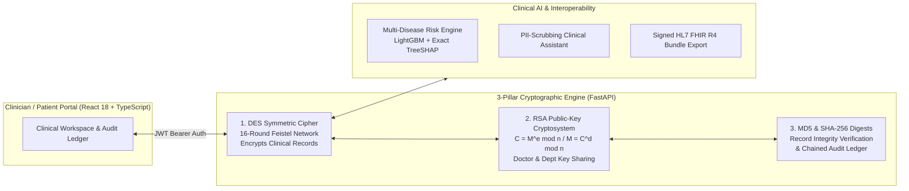

# AegisEHR — Secure Healthcare Information System & Clinical AI Platform

**Live Deployment:** [https://secure-ehr.vercel.app](https://secure-ehr.vercel.app)  
**GitHub Repository:** [https://github.com/ezylopx5/secure-ehr](https://github.com/ezylopx5/secure-ehr)

AegisEHR is an end-to-end **Electronic Health Record (EHR) and Privacy-Preserving Clinical Risk Prediction Platform** built with **FastAPI**, **React 18 + TypeScript**, and **LightGBM / TreeSHAP**. Instead of using unnecessary or artificial cryptographic tabs, AegisEHR places **three foundational cryptographic algorithms directly in their natural EHR workflows**:

1. **Data Encryption Standard (DES)** — Symmetric 64-bit Feistel block cipher (16 rounds, Initial Permutation $IP$, 32-to-48-bit Expansion $E$, 8 S-boxes, P-box, and $FP = IP^{-1}$) for encrypting and decrypting clinical record payloads at rest (`backend/app/crypto/classical_crypto.py`).
2. **RSA Public-Key Cryptosystem** — Asymmetric encryption and decryption ($n = p \times q$, $\phi(n) = (p-1)(q-1)$, $e \cdot d \equiv 1 \pmod{\phi(n)}$, $C = M^e \bmod n$, $M = C^d \bmod n$) for wrapping and sharing clinical record keys across authorized doctors and hospital departments.
3. **MD5 & SHA-256 Message Digests** — Dual cryptographic hashing (128-bit MD5 + 256-bit SHA-256) to verify clinical record integrity (`GET /api/patients/{id}/records/{rid}/verify`) and chain every clinical action into a tamper-evident SHA-256 audit ledger.

---

## Core Architecture & Features



### 1. Where Each Cryptographic Algorithm is Used in the EHR
| EHR Workflow Stage | Cryptographic Algorithm Used | Mathematical Operation & Purpose | Code Location |
| :--- | :--- | :--- | :--- |
| **Saving & Viewing Clinical Records** | **DES (Data Encryption Standard)** | 64-bit block cipher with 16 Feistel rounds ($L_i = R_{i-1}$, $R_i = L_{i-1} \oplus f(R_{i-1}, K_i)$) encrypts patient lab results and clinical notes before database storage. | `backend/app/crypto/classical_crypto.py` (`des_encrypt`, `des_decrypt`) |
| **Cross-Department Record Sharing** | **RSA Cryptosystem** | Generates public key $(e, n)$ and private key $(d, n)$ where $n = p \times q$ and $d \equiv e^{-1} \pmod{\phi(n)}$. Wraps record keys via $C = M^e \bmod n$ and unwraps via $M = C^d \bmod n$ for authorized specialists. | `backend/app/crypto/classical_crypto.py` (`rsa_generate_keys`, `rsa_encrypt_text`, `rsa_decrypt_cipher`) |
| **Record Integrity & Audit Ledger** | **MD5 & SHA-256 Message Digests** | Computes 128-bit MD5 and 256-bit SHA-256 message digests on canonical clinical JSON (`H(m) == H(m')`) and links audit blocks via $\text{block\_hash}_k = \text{SHA256}(\text{block\_hash}_{k-1} \parallel \text{payload}_k)$. | `backend/app/crypto/integrity.py`, `backend/app/services/record_service.py` |

### 2. Multi-Disease Clinical AI + Exact TreeSHAP Explainability
- Evaluates **Type-2 Diabetes**, **Cardiovascular Disease**, **Chronic Kidney Disease**, and **Liver Disease**.
- Computes calibrated risk probabilities (`low`, `moderate`, `high`) and exact **TreeSHAP** per-biomarker attributions rendered as interactive horizontal contribution bars in the UI.

### 3. PII-Scrubbing Clinical AI Assistant & Signed HL7 FHIR R4 Export
- Automatically scrubs direct identifiers (`[PHONE]`, `[EMAIL]`, `[SSN]`, `[MRN]`) prior to clinical summarization.
- Exports standards-compliant **HL7 FHIR R4 Collection Bundles** (`Patient`, `Observation`, `RiskAssessment`) signed with SHA-256 and HMAC-SHA256.

---

## Quick Start (Local Development)

### 1. Backend (FastAPI + Python 3.11+)
```bash
cd backend
python3 -m venv .venv
source .venv/bin/activate
pip install -r requirements.txt
uvicorn app.main:app --reload --port 8000
```
- **API Docs (Swagger UI):** `http://localhost:8000/docs`
- **Automated Test Suite:**
  ```bash
  cd backend
  ./.venv/bin/pytest -q
  ```

### 2. Frontend (React 18 + Vite + TypeScript)
```bash
cd frontend
npm install
npm run dev
```
- **Web Application:** `http://localhost:5173`

---

## Pre-Seeded Demo Accounts (One-Click Persona Switcher)

| Role | Email | Password | Department | Capabilities |
| :--- | :--- | :--- | :--- | :--- |
| **Doctor** | `dr.patel@nitsurat.ac.in` | `Doctor@123` | `cardiology` | Encrypt records (DES), share records (RSA), verify MD5/SHA-256 digests, run AI risk & FHIR export |
| **Patient** | `arjun.mehta@patient.org` | `Patient@123` | `general` | View own decrypted records, grant or revoke doctor consent |
| **Auditor** | `auditor@nitsurat.ac.in` | `Auditor@123` | `compliance` | Verify MD5 & SHA-256 record digests and validate the SHA-256 audit hash chain without seeing plaintext PHI |
| **Admin** | `admin@nitsurat.ac.in` | `Admin@123` | `general` | Full system oversight and cross-department record management |

---

## Documentation
- **[Cryptographic Architecture (`docs/CRYPTOGRAPHY.md`)](docs/CRYPTOGRAPHY.md)** — Mathematical formulations and EHR workflow mapping for **DES**, **RSA**, and **MD5 & SHA-256**.
- **[Full Project Report (`docs/PROJECT_REPORT.md`)](docs/PROJECT_REPORT.md)** — Comprehensive academic project report with architecture diagrams, equations, test results, and viva reference.
