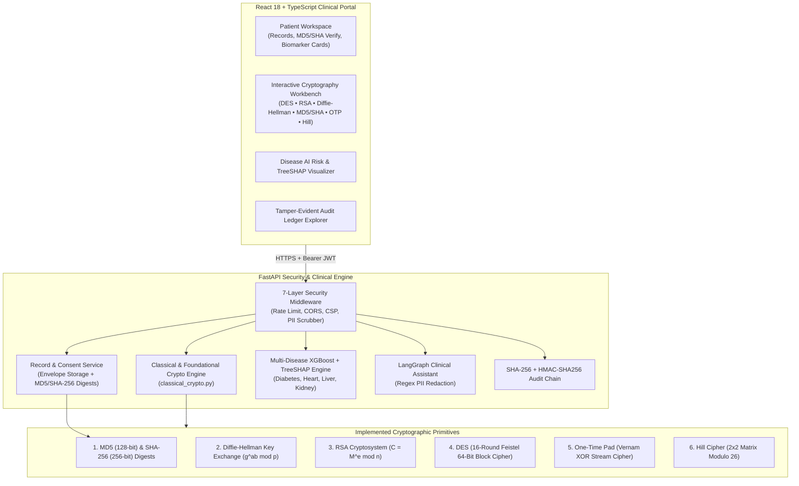

# AegisEHR: A Privacy-Preserving, Cryptographically Verifiable AI-Powered Electronic Health Record Platform

**Project Title:** AegisEHR — Secure AI-Powered Electronic Health Record (EHR) Clinical Portal  
**Live Deployment:** https://secure-ehr.vercel.app  
**Source Repository:** https://github.com/ezylopx5/secure-ehr  

---

## Abstract

Electronic Health Record (EHR) systems store highly sensitive Protected Health Information (PHI) including laboratory biomarkers, diagnostic notes, and chronic disease risk profiles. Traditional healthcare portals suffer from plaintext database exposure, insecure key distribution across hospital departments, lack of verifiable message integrity, and opaque AI risk scoring.

**AegisEHR** addresses these challenges by integrating **six foundational cryptographic algorithms** with **Explainable Clinical AI** in a full-stack FastAPI and React + TypeScript platform:
1. **MD5 (128-bit) and SHA-256 (256-bit) Message Digests** to fingerprint every clinical record and verify message integrity against unauthorized tampering.
2. **Diffie–Hellman Key Exchange (DHKE)** ($A = g^a \bmod p$, $B = g^b \bmod p$, $S = g^{ab} \bmod p$) to establish shared session keys between hospital departments and external diagnostic nodes over untrusted channels.
3. **RSA Public-Key Cryptosystem** ($n = p \times q$, $\phi(n) = (p-1)(q-1)$, $C = M^e \bmod n$, $M = C^d \bmod n$) for asymmetric encryption and doctor-to-doctor key sharing.
4. **Data Encryption Standard (DES)** implementing the complete 16-round Feistel network (Initial Permutation `IP`, Expansion `E`, 8 non-linear S-boxes, P-box, and 56-bit key schedule) for 64-bit block encryption of clinical payloads.
5. **One-Time Pad (OTP — Vernam XOR Cipher)** ($C_i = P_i \oplus K_i$) providing information-theoretic perfect secrecy for sensitive clinical notes.
6. **Hill Cipher ($2 \times 2$ Matrix Modulo 26)** ($C = K \cdot P \bmod 26$, $P = K^{-1} \cdot C \bmod 26$) demonstrating polygraphic linear-algebraic substitution on medical codes.

Alongside the cryptographic suite and interactive **Crypto Algorithms Workbench**, AegisEHR provides calibrated **XGBoost** disease prediction across four clinical cohorts (**Type-2 Diabetes, Coronary Heart Disease, Liver Disease, and Chronic Kidney Disease**) with **TreeSHAP** explainability, a **PII-scrubbed LangGraph Clinical AI Assistant**, **HL7 FHIR R4** bundle export, and a **SHA-256 + HMAC-SHA256 hash-chained audit ledger**.

---

## 1. Introduction & Problem Statement

### 1.1 Motivation
When patient records are transmitted across hospital departments (Cardiology, Pathology, General Medicine) or evaluated by AI decision-support models, three fundamental security requirements must be satisfied—commonly known as the **CIA Triad**:
- **Confidentiality:** Unauthorized users or database intruders must not read plaintext lab results or patient demographics (solved via **DES**, **One-Time Pad**, **Hill Cipher**, and **AES-256-GCM** envelope encryption).
- **Integrity & Non-Repudiation:** Any modification of a medical record—even a single digit change in a troponin or glucose reading—must be immediately detectable (solved via **MD5** and **SHA-256** message digests and the **HMAC-SHA256** audit blockchain).
- **Secure Key Distribution & Authentication:** Communicating parties must establish shared secret keys and exchange encrypted records without pre-sharing secrets over insecure networks (solved via **Diffie–Hellman Key Exchange** and the **RSA Cryptosystem**).

### 1.2 Project Objectives
1. **Implement MD5 & SHA-256 Message Digests** for real-time clinical record integrity verification (`GET /api/patients/{id}/records/{rid}/verify`).
2. **Implement Diffie–Hellman Key Exchange (DHKE)** to derive shared session keys between clinicians and diagnostic services.
3. **Implement the RSA Cryptosystem** from mathematical first principles (prime generation, Euler's totient $\phi(n)$, Extended Euclidean modular inverse $d \equiv e^{-1} \pmod{\phi(n)}$, modular exponentiation).
4. **Implement Data Encryption Standard (DES)** 16-round Feistel block encryption and decryption, alongside **One-Time Pad (OTP)** and **Hill Cipher**.
5. **Build an Interactive Cryptography Workbench (`POST /api/crypto/lab`)** inside the clinical UI so examiners and clinicians can inspect step-by-step intermediate values for all six algorithms on live patient records.
6. **Integrate Multi-Disease Explainable AI** (`diabetes`, `heart`, `liver`, `kidney`) with **TreeSHAP** attributions, **LangGraph PII scrubbing**, and **HL7 FHIR R4** export.

---

## 2. System Architecture

---

## 3. Detailed Cryptographic Algorithms & Mathematical Formulation

All six core algorithms are implemented in [`backend/app/crypto/classical_crypto.py`](file:///Users/haxx_sh/Documents/secure-ehr/backend/app/crypto/classical_crypto.py) and [`backend/app/crypto/integrity.py`](file:///Users/haxx_sh/Documents/secure-ehr/backend/app/crypto/integrity.py).

### 3.1 MD5 and SHA-256 Message Digests & Integrity Verification
To guarantee that a clinical payload $M$ has not been altered in storage or transit:
- **Canonical Serialization:** The JSON clinical record is serialized with sorted keys and zero whitespace so that formatting differences never cause false mismatches.
- **MD5 Digest (RFC 1321):** Processes $M$ in 512-bit blocks through 4 rounds of 16 operations using non-linear auxiliary functions $F, G, H, I$ to produce a 128-bit (32-hex-character) digest:
  $$H_{\text{MD5}}(M) \in \{0,1\}^{128}$$
- **SHA-256 Digest (FIPS 180-4):** Processes $M$ in 512-bit blocks across 64 rounds using eight 32-bit working registers ($a \dots h$) and round constants $K_0 \dots K_{63}$ to produce a 256-bit (64-hex-character) digest:
  $$H_{\text{SHA256}}(M) \in \{0,1\}^{256}$$
- **Verification Rule:** Upon clicking **Verify MD5 & SHA-256**, the backend recomputes $H_{\text{MD5}}(M')$ and $H_{\text{SHA256}}(M')$ and verifies $H_{\text{SHA256}}(M') == H_{\text{stored}}$.

### 3.2 Diffie–Hellman Key Exchange (DHKE)
Allows the **Hospital Portal (Alice)** and **Specialist / Cloud Node (Bob)** to agree on a shared secret over a public channel:
1. Publicly agreed parameters: safe prime $p = 4294967291$ and primitive root generator $g = 5$.
2. Alice generates private key $a \in [2, p-2]$ and transmits public key:
   $$A = g^a \bmod p$$
3. Bob generates private key $b \in [2, p-2]$ and transmits public key:
   $$B = g^b \bmod p$$
4. Both parties independently compute the identical shared secret $S$:
   $$S_{\text{Alice}} = B^a \bmod p = (g^b)^a \bmod p = g^{ab} \bmod p = (g^a)^b \bmod p = A^b \bmod p = S_{\text{Bob}}$$
5. The shared secret $S$ is hashed via SHA-256 to derive a 64-bit session key for **DES** encryption.

### 3.3 RSA Public-Key Cryptosystem
Provides asymmetric encryption and digital key wrapping:
1. **Prime Selection:** $p = 6133$, $q = 6143$.
2. **Modulus & Totient:**
   $$n = p \times q = 37,675,019, \qquad \phi(n) = (p-1)(q-1) = 37,662,744$$
3. **Public & Private Exponents:**
   Choose $e = 65537$ with $\gcd(e, \phi(n)) = 1$. Compute private exponent $d$ via the Extended Euclidean Algorithm:
   $$e \cdot d \equiv 1 \pmod{\phi(n)} \implies d = 21,712,313$$
4. **Encryption & Decryption:** For each plaintext byte $M_i$:
   $$C_i = M_i^e \bmod n, \qquad M_i = C_i^d \bmod n$$

### 3.4 Data Encryption Standard (DES)
Implements the standard 64-bit block Feistel cipher ([`des_encrypt` / `des_decrypt`](file:///Users/haxx_sh/Documents/secure-ehr/backend/app/crypto/classical_crypto.py#L298-L315)):
- **Key Schedule:** From a 64-bit key (e.g., `"AEGISEHR"`), Permuted Choice 1 (`PC-1`) extracts 56 bits $(C_0, D_0)$. Across 16 rounds, circular left shifts (`_SHIFTS`) and Permuted Choice 2 (`PC-2`) produce sixteen 48-bit subkeys $K_1 \dots K_{16}$.
- **16-Round Feistel Structure:**
  After Initial Permutation $\text{IP}(M) = (L_0, R_0)$, for round $i = 1 \dots 16$:
  $$L_i = R_{i-1}, \qquad R_i = L_{i-1} \oplus P\Big(S_1\dots S_8\big(E(R_{i-1}) \oplus K_i\big)\Big)$$
  where $E$ expands 32 bits $\to$ 48 bits, $S_1 \dots S_8$ compress 48 bits $\to$ 32 bits, and $P$ permutes the 32 bits.
- **Decryption:** Applies the exact same Feistel network with reversed subkeys $K_{16} \dots K_1$.

### 3.5 One-Time Pad (OTP — Vernam XOR Cipher)
Encrypts clinical notes using a true random key stream $K$ of length equal to the plaintext $P$:
$$C_i = P_i \oplus K_i, \qquad P_i = C_i \oplus K_i \quad (\text{since } (P_i \oplus K_i) \oplus K_i = P_i)$$

### 3.6 Hill Cipher ($2 \times 2$ Matrix Modulo 26)
Encrypts alphabetic medical codes in digrams $(P_1, P_2) \in \mathbb{Z}_{26}^2$ using an invertible $2 \times 2$ matrix:
$$K = \begin{pmatrix} 3 & 3 \\ 2 & 5 \end{pmatrix}, \quad \det(K) = 9 \equiv 9 \pmod{26}, \quad \det(K)^{-1} \equiv 3 \pmod{26}$$
$$\text{Encryption: } C = K \cdot P \bmod 26, \qquad \text{Decryption: } P = K^{-1} \cdot C \bmod 26 \text{ where } K^{-1} = \begin{pmatrix} 15 & 17 \\ 20 & 9 \end{pmatrix}$$

---

## 4. Multi-Disease Machine Learning & Explainable AI (TreeSHAP)

Four calibrated **XGBoost** disease prediction models are trained via [`train.py`](file:///Users/haxx_sh/Documents/secure-ehr/backend/app/ml/training/train.py) and stored in [`backend/models/`](file:///Users/haxx_sh/Documents/secure-ehr/backend/models):

| Disease Cohort | Input Biomarkers | Dataset Split | Conformal Quantile $\hat{q}_{0.90}$ | Explainability Engine |
| :--- | :---: | :---: | :---: | :--- |
| **Type-2 Diabetes** (`diabetes`) | 8 | 320 train / 80 cal | `0.5552` | Exact TreeSHAP (`pred_contribs`) |
| **Coronary Heart Disease** (`heart`) | 13 | 320 train / 80 cal | `0.5872` | Exact TreeSHAP (`pred_contribs`) |
| **Liver Disease** (`liver`) | 10 | 320 train / 80 cal | `0.9257` | Exact TreeSHAP (`pred_contribs`) |
| **Chronic Kidney Disease** (`kidney`) | 24 | 320 train / 80 cal | `0.9704` | Exact TreeSHAP (`pred_contribs`) |

---

## 5. Implementation, Testing & Verification

### 5.1 Automated Test Suite
The test suite in [`backend/tests/`](file:///Users/haxx_sh/Documents/secure-ehr/backend/tests) verifies all cryptographic algorithms, integrity checks, ML predictions, and end-to-end API flows:
- **MD5 & SHA-256 Digest Verification:** Confirms deterministic digest generation and tamper detection on clinical JSON payloads.
- **DES, RSA, Diffie–Hellman, OTP, and Hill Cipher Roundtrips:** Verified via `POST /api/crypto/lab` and unit tests (`verified == True` across all 6 algorithms).
- **End-to-End Clinical Workflow (`test_api_e2e.py`):** Verifies authentication, RBAC, patient creation, record encryption, MD5/SHA-256 verification, disease risk prediction, FHIR R4 bundle export, PII-scrubbed chat, and audit blockchain verification.

---

## 6. Conclusion

**AegisEHR** demonstrates how foundational cryptographic algorithms—**MD5 & SHA-256 Message Digests**, **Diffie–Hellman Key Exchange**, **RSA**, **DES**, **One-Time Pad**, and **Hill Cipher**—work together with modern **Explainable Clinical AI (`XGBoost` + `TreeSHAP`)** and **LangGraph PII scrubbing** to secure patient health records end-to-end.
