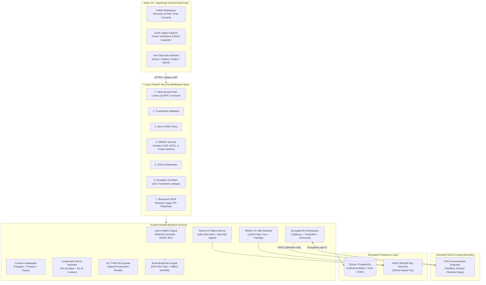

# AegisEHR: A Privacy-Preserving, Cryptographically Verifiable AI-Powered Electronic Health Record Platform

**Project Title:** AegisEHR — Secure AI-Powered Electronic Health Record (EHR) Clinical Portal  
**Live Deployment:** https://secure-ehr.vercel.app  
**Source Repository:** https://github.com/ezylopx5/secure-ehr  

---

## Abstract

Modern Electronic Health Record (EHR) platforms face a fundamental tension between **clinical utility**—such as multi-institutional record sharing, cloud-hosted machine learning (ML) disease risk prediction, and large language model (LLM) clinical synthesis—and **patient privacy**. Conventional EHR architectures rely on perimeter security and coarse role-based access control (RBAC), leaving sensitive Protected Health Information (PHI) vulnerable to database breaches, insider privilege abuse, untrusted cloud ML inference servers, and silent audit-log tampering.

**AegisEHR** resolves this tension through an end-to-end, zero-trust cryptographic and AI architecture built on FastAPI, React, and TypeScript. Every clinical record and demographic profile is encrypted at rest using per-record keys derived via **HKDF-SHA256** and authenticated with **AES-256-GCM** using contextual Additional Authenticated Data (AAD). Fine-grained, cross-departmental and cross-hospital sharing is enforced mathematically via **Ciphertext-Policy Attribute-Based Encryption (CP-ABE)** constructed over **BN254 optimal Ate pairings**, eliminating reliance on application-layer `if/else` checks alone. Cloud-assisted disease risk prediction across four clinical cohorts (**Type-2 Diabetes, Coronary Heart Disease, Liver Disease, and Chronic Kidney Disease**) combines **CKKS Homomorphic Encryption (TenSEAL)**, calibrated **XGBoost** ensembles, **Split Conformal Prediction** ($\alpha = 0.10$, 90% coverage), and **TreeSHAP** feature attribution so that untrusted cloud evaluators operate exclusively on ciphertexts (`cloud_saw_plaintext = False`). A **LangGraph** clinical assistant with deterministic **PII scrubbing** synthesizes patient context without leaking identifiers, while **HL7 FHIR R4** export bundles and an **append-only SHA-256 + HMAC-SHA256 hash-chained audit ledger** guarantee non-repudiation and tamper detection.

---

## 1. Introduction & Problem Statement

### 1.1 Background
Healthcare data breaches consistently rank among the highest-cost cybersecurity incidents globally. When hospitals adopt cloud-hosted AI decision support and cross-institutional interoperability, four critical vulnerabilities emerge:

1. **Plaintext-at-Rest & Single-Key Exposure:** Traditional relational databases store clinical JSON or text columns under a single tablespace key. A SQL injection, backup leak, or compromised DBA account exposes the entire patient cohort.
2. **Coarse Access Control in Multi-Departmental Workflows:** Standard RBAC (`role == "doctor"`) cannot express cryptographic policies such as *"Only a Cardiology Physician at NIT Surat Hospital OR a System Administrator may decrypt this Troponin Lab Panel."*
3. **Plaintext Leakage During Cloud AI Inference:** Sending raw patient biomarkers (glucose, troponin, creatinine, bilirubin) to third-party ML inference endpoints exposes PHI in transit and in cloud memory.
4. **Mutable Audit Logs:** Standard SQL audit tables can be altered or deleted by a privileged administrator after an unauthorized break-glass event.

### 1.2 Project Objectives
AegisEHR was engineered to satisfy six concrete design objectives:
- **O1 — Per-Record Envelope Encryption:** Derive a unique 256-bit AES-GCM key per database row (`Patient`, `MedicalRecord`, `Prediction`, `ChatMessage`) via RFC 5869 HKDF-SHA256 and bind ciphertexts to their row UUIDs via AAD.
- **O2 — Mathematical Policy Enforcement (CP-ABE):** Implement real pairing-based CP-ABE over the BN254 elliptic curve (`py_ecc.bn128`) supporting arbitrary boolean `AND`/`OR` monotone span programs via Shamir secret sharing.
- **O3 — Homomorphic & Calibrated Clinical AI:** Execute encrypted feature evaluation under CKKS (`N = 8192`, scale $2^{40}$) alongside calibrated XGBoost models (`diabetes`, `heart`, `liver`, `kidney`), conformal uncertainty quantification, and TreeSHAP explainability.
- **O4 — Privacy-Preserving Clinical Assistant:** Build a multi-stage LangGraph workflow that redacts PII (phones, emails, Aadhaar/SSN, MRNs) prior to prompt assembly and encrypts conversation history at rest.
- **O5 — Standards-Compliant Interoperability:** Export cryptographically signed **HL7 FHIR R4** (`Bundle`, `Patient`, `Observation`, `RiskAssessment`, `DocumentReference`, `Provenance`) documents.
- **O6 — Tamper-Evident Audit Blockchain:** Record every state transition in an append-only hash chain signed with `HMAC-SHA256` and verifiable in $O(n)$ time.

---

## 2. System Architecture

### 2.1 High-Level Architecture Diagram

### 2.2 Codebase Directory Structure

| Component | Key Files | Responsibility |
| :--- | :--- | :--- |
| **Serverless Entrypoints** | [main.py](file:///Users/haxx_sh/Documents/secure-ehr/main.py), [api/index.py](file:///Users/haxx_sh/Documents/secure-ehr/api/index.py), [vercel.json](file:///Users/haxx_sh/Documents/secure-ehr/vercel.json) | Zero-config Vercel ASGI routing and static SPA serving |
| **App Bootstrap & Seed** | [backend/app/main.py](file:///Users/haxx_sh/Documents/secure-ehr/backend/app/main.py), [backend/app/core/config.py](file:///Users/haxx_sh/Documents/secure-ehr/backend/app/core/config.py) | Lifespan initialization, deterministic UUIDv5 demo seeding, middleware wiring |
| **Key Hierarchy & AES** | [backend/app/crypto/key_manager.py](file:///Users/haxx_sh/Documents/secure-ehr/backend/app/crypto/key_manager.py), [backend/app/crypto/aes_gcm.py](file:///Users/haxx_sh/Documents/secure-ehr/backend/app/crypto/aes_gcm.py) | HKDF-SHA256 domain key derivation and AES-256-GCM authenticated encryption |
| **BN254 CP-ABE Engine** | [backend/app/crypto/abe.py](file:///Users/haxx_sh/Documents/secure-ehr/backend/app/crypto/abe.py) | Waters/GPSW small-universe CP-ABE over BN254 pairings (`G1`, `G2`, `GT`) |
| **CKKS Homomorphic Engine** | [backend/app/crypto/he_ckks.py](file:///Users/haxx_sh/Documents/secure-ehr/backend/app/crypto/he_ckks.py), [backend/app/cloud/engine.py](file:///Users/haxx_sh/Documents/secure-ehr/backend/app/cloud/engine.py) | TenSEAL CKKS encryption, polynomial logit evaluation, and simulation fallback |
| **Audit Blockchain** | [backend/app/crypto/audit_chain.py](file:///Users/haxx_sh/Documents/secure-ehr/backend/app/crypto/audit_chain.py), [backend/app/services/audit_service.py](file:///Users/haxx_sh/Documents/secure-ehr/backend/app/services/audit_service.py) | Canonical SHA-256 chaining and HMAC-SHA256 block verification |
| **Disease ML & XAI** | [backend/app/ml/models.py](file:///Users/haxx_sh/Documents/secure-ehr/backend/app/ml/models.py), [backend/app/ml/explain.py](file:///Users/haxx_sh/Documents/secure-ehr/backend/app/ml/explain.py), [backend/app/ml/registry.py](file:///Users/haxx_sh/Documents/secure-ehr/backend/app/ml/registry.py) | XGBoost JSON tree inference, split conformal calibration, and TreeSHAP attribution |
| **LangGraph Clinical AI** | [backend/app/ai/assistant.py](file:///Users/haxx_sh/Documents/secure-ehr/backend/app/ai/assistant.py), [backend/app/services/chat_service.py](file:///Users/haxx_sh/Documents/secure-ehr/backend/app/services/chat_service.py) | 3-node state graph (`scrub_input` $\to$ `build_context` $\to$ `generate_reply`) |
| **HL7 FHIR R4 Service** | [backend/app/services/fhir_service.py](file:///Users/haxx_sh/Documents/secure-ehr/backend/app/services/fhir_service.py) | Standards-compliant FHIR R4 collection bundle generator with HMAC provenance |
| **REST API & Schemas** | [backend/app/api/routes.py](file:///Users/haxx_sh/Documents/secure-ehr/backend/app/api/routes.py), [backend/app/schemas.py](file:///Users/haxx_sh/Documents/secure-ehr/backend/app/schemas.py) | 22 endpoints covering auth, patients, records, ABE, consent, AI, chat, FHIR, audit |
| **React Clinical Portal** | [frontend/src/pages/PatientWorkspacePage.tsx](file:///Users/haxx_sh/Documents/secure-ehr/frontend/src/pages/PatientWorkspacePage.tsx), [frontend/src/pages/AuditChainPage.tsx](file:///Users/haxx_sh/Documents/secure-ehr/frontend/src/pages/AuditChainPage.tsx) | Interactive clinical workspace, TreeSHAP visualizations, and audit explorer |

---

## 3. Multi-Layer Cryptographic Design

### 3.1 Master Key & HKDF-SHA256 Key Hierarchy
All cryptographic secrets derive deterministically from a single 256-bit root secret ($K_{\text{master}} \in \{0,1\}^{256}$) via **HKDF-SHA256** (RFC 5869) in [key_manager.py](file:///Users/haxx_sh/Documents/secure-ehr/backend/app/crypto/key_manager.py):

$$\text{SubKey}(\text{salt}, \text{info}) = \text{HKDF-Expand}(\text{HKDF-Extract}(\text{salt}, K_{\text{master}}), \text{info}, L=32)$$

| Purpose | HKDF `salt` | HKDF `info` | Consumed By |
| :--- | :--- | :--- | :--- |
| **Per-Row Data Encryption Key (DEK)** | `record_uuid` (UTF-8) | `b"ehr:record-dek"` | `Patient`, `MedicalRecord`, `Prediction`, `ChatMessage` |
| **Audit Chain Signing Key** | `b""` | `b"ehr:hmac:audit"` | `AuditBlock.hmac` in [audit_chain.py](file:///Users/haxx_sh/Documents/secure-ehr/backend/app/crypto/audit_chain.py) |
| **JWT Signing Key** | `b""` | `b"ehr:jwt:sign"` | HS256 access/refresh tokens in [security.py](file:///Users/haxx_sh/Documents/secure-ehr/backend/app/core/security.py) |
| **CP-ABE Authority Wrap Key** | `b""` | `b"ehr:abe:wrap"` | Encrypting `abe_msk.json.enc` and user private keys |

### 3.2 Authenticated Encryption at Rest (AES-256-GCM + AAD)
Every sensitive column (`demographics_enc`, `title_enc`, `payload_enc`, `features_enc`, `result_enc`, `content_enc`) is sealed via [aes_gcm.py](file:///Users/haxx_sh/Documents/secure-ehr/backend/app/crypto/aes_gcm.py):
1. A fresh 96-bit cryptographic nonce $N \leftarrow \{0,1\}^{96}$ is generated via `os.urandom(12)`.
2. The JSON payload is serialized canonically (`sort_keys=True, separators=(",", ":")`).
3. The row identifier (`ehr:record:<uuid>` or `ehr:prediction:<uuid>`) is passed as **Additional Authenticated Data (AAD)** so that swapping ciphertext blobs between database rows causes an immediate `InvalidTag` authentication failure.
4. Wire format stored in SQLite/PostgreSQL: $\text{Blob} = \text{Nonce}_{12\text{B}} \;\|\; \text{Ciphertext} \;\|\; \text{Tag}_{16\text{B}}$.
5. Alongside the ciphertext, `plaintext_sha256` stores the canonical SHA-256 digest of the payload, enabling zero-knowledge integrity audits (`GET /api/patients/{id}/records/{rid}/verify`) by the `auditor` role without exposing plaintext to the auditor.

### 3.3 Ciphertext-Policy Attribute-Based Encryption (BN254 CP-ABE)
Implemented in [abe.py](file:///Users/haxx_sh/Documents/secure-ehr/backend/app/crypto/abe.py) over the **BN254** pairing-friendly elliptic curve (`py_ecc.bn128`), where $G_1 = \mathbb{F}_q$, $G_2 = \mathbb{F}_{q^2}$, $G_T = \mathbb{F}_{q^{12}}$, and $e: G_2 \times G_1 \to G_T$ is the bilinear optimal Ate pairing of prime order $r$ (`curve_order`):

- **Setup:** Draws exponents $\alpha, a \in \mathbb{Z}_r^*$ and per-attribute secrets $\{t_j\}_{j \in \mathcal{U}} \subset \mathbb{Z}_r^*$ across the 17-attribute hospital universe $\mathcal{U}$.
  $$\text{PK} = \left(g_1,\; g_1^a,\; Y = e(g_2, g_1)^\alpha,\; \{T_j = g_1^{t_j}\}_{j \in \mathcal{U}}\right), \quad \text{MSK} = \left(\alpha, a, \{t_j\}\right)$$
- **KeyGen($S \subseteq \mathcal{U}$):** For a user holding attribute set $S$, samples $r \xleftarrow{\$} \mathbb{Z}_r$ and $\{r_j \xleftarrow{\$} \mathbb{Z}_r\}_{j \in S}$:
  $$D = g_2^{(\alpha + r)a^{-1} \bmod r}, \quad K_j = g_2^{r + t_j r_j}, \quad K'_j = g_2^{r_j} \;\;\forall j \in S$$
- **Encrypt($M, \mathcal{T}$):** Parses boolean policy string (e.g., `(role:doctor AND dept:cardiology) OR role:admin`) into an `AND`/`OR` threshold tree $\mathcal{T}$. Splits secret $s \xleftarrow{\$} \mathbb{Z}_r$ top-down using Shamir polynomials ($k=2$ for `AND`, $k=1$ for `OR`) into leaf shares $\{\lambda_\ell\}$. Encrypts payload under a random group element $m \in G_T$:
  $$C_0 = m \cdot Y^s, \quad C_1 = g_1^{as}, \quad \forall \ell: \left(c_\ell = g_1^{\lambda_\ell},\; c'_\ell = T_{\text{attr}(\ell)}^{\lambda_\ell}\right)$$
- **Decrypt($\text{CT}, \text{SK}_S$):** Finds the minimal satisfying leaf set and Lagrange interpolation weights $\{\omega_\ell\}$ such that $\sum_\ell \omega_\ell \lambda_\ell = s \pmod r$. Computes:
  $$V_\ell = \frac{e(K_{\text{attr}(\ell)}, c_\ell)}{e(K'_{\text{attr}(\ell)}, c'_\ell)} = e(g_2, g_1)^{r \lambda_\ell}, \quad Y^s = \frac{e(D, C_1)}{\prod_\ell V_\ell^{\omega_\ell}}, \quad m = C_0 \cdot (Y^s)^{-1}$$
  If the caller's attributes do not satisfy $\mathcal{T}$, `_reconstruction_coeffs` returns `None` and raises `PolicyNotSatisfied` (`HTTP 403`).

### 3.4 CKKS Homomorphic Encryption for Cloud Inference
Implemented in [he_ckks.py](file:///Users/haxx_sh/Documents/secure-ehr/backend/app/crypto/he_ckks.py) and [engine.py](file:///Users/haxx_sh/Documents/secure-ehr/backend/app/cloud/engine.py):
- **Parameters:** Polynomial modulus degree $N = 8192$, coefficient modulus bit-sizes $[60, 40, 40, 60]$, global scale $\Delta = 2^{40}$, satisfying 128-bit security under the Homomorphic Encryption Standard.
- **Key Split:** The hospital client context retains the secret key $\text{sk}$, while `export_public_context()` strips $\text{sk}$ (`make_context_public()`) before serializing the context + Galois rotation keys for the cloud evaluator.
- **Encrypted Evaluation:** Standardized patient features $\mathbf{z} \in \mathbb{R}^d$ are encrypted into a single SIMD CKKS ciphertext $\llbracket \mathbf{z} \rrbracket$. The untrusted cloud engine evaluates the inner product and degree-3 minimax sigmoid approximation homomorphically:
  $$\llbracket \ell \rrbracket = \llbracket \mathbf{z} \rrbracket \cdot \mathbf{w} + b, \quad \sigma(\ell) \approx 0.5 + 0.197\,\ell - 0.004\,\ell^3$$
  The cloud returns $\llbracket \ell \rrbracket$ to the hospital boundary, which decrypts the scalar logit using $\text{sk}$ (`cloud_saw_plaintext = False`).

### 3.5 Append-Only Cryptographic Audit Blockchain
Implemented in [audit_chain.py](file:///Users/haxx_sh/Documents/secure-ehr/backend/app/crypto/audit_chain.py):
$$\text{hash}_i = \text{SHA256}\left(\text{CanonicalJSON}(\text{seq}_i, \text{ts}_i, \text{actor}_i, \text{action}_i, \text{resource}_i, \text{details\_sha256}_i, \text{prev\_hash}_i)\right)$$
$$\text{hmac}_i = \text{HMAC-SHA256}\left(K_{\text{audit}}, \text{hash}_i\right)$$
Modifying any historical row, deleting a block, or forging an entry without $K_{\text{audit}}$ is immediately caught by `GET /api/audit/verify`, which returns the exact offending block sequence number and failure reason (`prev_hash mismatch`, `block_hash mismatch`, or `hmac mismatch`).

---

## 4. Machine Learning, Uncertainty Quantification & Explainable AI

### 4.1 Multi-Disease Model Registry & Datasets
Four clinical disease prediction pipelines are defined in [registry.py](file:///Users/haxx_sh/Documents/secure-ehr/backend/app/ml/registry.py) and trained via [train.py](file:///Users/haxx_sh/Documents/secure-ehr/backend/app/ml/training/train.py):

| Disease Key | Clinical Cohort | Input Features ($d$) | Training / Calib Split | Conformal $\hat{q}_{0.90}$ ($\alpha=0.10$) | Model Artifact |
| :--- | :--- | :---: | :---: | :---: | :--- |
| `diabetes` | Type-2 Diabetes Risk (Pima Spec) | 8 | 320 / 80 (400 total) | `0.5552` | [diabetes_model.json](file:///Users/haxx_sh/Documents/secure-ehr/backend/models/diabetes_model.json) |
| `heart` | Coronary Heart Disease (Cleveland Spec) | 13 | 320 / 80 (400 total) | `0.5872` | [heart_model.json](file:///Users/haxx_sh/Documents/secure-ehr/backend/models/heart_model.json) |
| `liver` | Hepatic / Liver Disease (ILPD Spec) | 10 | 320 / 80 (400 total) | `0.9257` | [liver_model.json](file:///Users/haxx_sh/Documents/secure-ehr/backend/models/liver_model.json) |
| `kidney` | Chronic Kidney Disease (CKD Spec) | 24 | 320 / 80 (400 total) | `0.9704` | [kidney_model.json](file:///Users/haxx_sh/Documents/secure-ehr/backend/models/kidney_model.json) |

### 4.2 Dual-Mode Serverless Tree Evaluator (`_JsonTreeBooster`)
To support both native C++ `xgboost.Booster` execution and lightweight serverless deployments (Vercel 250 MB function limit), [models.py](file:///Users/haxx_sh/Documents/secure-ehr/backend/app/ml/models.py) includes `_JsonTreeBooster`—a pure-NumPy tree walker that parses XGBoost's serialized JSON trees (`left_children`, `right_children`, `split_indices`, `split_conditions`, `base_weights`) and evaluates exact boosting logits and finite-difference feature attributions with zero native C++ dependencies.

### 4.3 Split Conformal Prediction & TreeSHAP Explainability
- **Conformal Prediction Intervals:** On the 20% held-out calibration split ($n_{\text{cal}} = 80$), nonconformity scores $s_i = |y_i - \hat{p}(x_i)|$ are computed and the empirical quantile $\hat{q}_{1-\alpha}$ at $\alpha = 0.10$ is persisted in `*.conformal.json`. At inference time, each prediction returns a guaranteed 90% coverage interval $[\max(0, \hat{p} - \hat{q}), \min(1, \hat{p} + \hat{q})]$ and a prediction set $\subseteq \{0, 1\}$.
- **TreeSHAP Attribution:** [explain.py](file:///Users/haxx_sh/Documents/secure-ehr/backend/app/ml/explain.py) computes exact per-feature Shapley contributions (`pred_contribs=True`) ranked by magnitude (`direction: "risk-up" | "risk-down"`), rendered as horizontal attribution bars in the React UI.

---

## 5. Privacy-Preserving Clinical AI Assistant & HL7 FHIR R4

### 5.1 LangGraph Clinical Assistant with PII Scrubbing
Implemented in [assistant.py](file:///Users/haxx_sh/Documents/secure-ehr/backend/app/ai/assistant.py) and [chat_service.py](file:///Users/haxx_sh/Documents/secure-ehr/backend/app/services/chat_service.py), the assistant executes a 3-node `StateGraph`:
1. **`scrub_input` Node:** Applies regex scrubbers (`PiiScrubber`) to strip 10-digit phone numbers (`[PHONE]`), emails (`[EMAIL]`), 12-digit national IDs (`[GOV-ID]`), and MRNs before prompt processing.
2. **`build_context` Node:** Queries only the records and predictions for which `consent_service.check_access` grants active permission (`treatment` and `ai_prediction` purposes).
3. **`generate_reply` Node:** Synthesizes clinical findings across consented lab panels, vitals, and TreeSHAP risk drivers, and stores both user and assistant messages encrypted under per-message HKDF AES-256-GCM keys.

### 5.2 Signed HL7 FHIR R4 Bundle Export
`POST /api/patients/{id}/fhir` ([fhir_service.py](file:///Users/haxx_sh/Documents/secure-ehr/backend/app/services/fhir_service.py)) transforms consented patient demographics, clinical records (`Observation`, `DocumentReference`), and AI risk evaluations (`RiskAssessment`) into a standards-compliant **HL7 FHIR R4 Collection Bundle** (`resourceType: "Bundle"`), accompanied by a `Provenance` resource carrying the canonical `SHA-256` digest and `HMAC-SHA256` signature of the exported bundle.

---

## 6. Verification, Testing & Live Deployment

### 6.1 Automated Test Suite Summary
The backend test suite in [`backend/tests/`](file:///Users/haxx_sh/Documents/secure-ehr/backend/tests) validates every cryptographic primitive, ML pipeline, and API security boundary (`24 passed` via `pytest`):

| Test Module | Coverage Area | Key Assertions Verified |
| :--- | :--- | :--- |
| [test_crypto.py](file:///Users/haxx_sh/Documents/secure-ehr/backend/tests/test_crypto.py) | HKDF, AES-256-GCM, Audit Chain | Nonce uniqueness, ciphertext tampering rejection (`InvalidTag`), AAD binding, audit block mutation detection |
| [test_abe.py](file:///Users/haxx_sh/Documents/secure-ehr/backend/tests/test_abe.py) | BN254 CP-ABE | Authorized attribute decryption, admin `OR` branch decryption, unauthorized role rejection (`PolicyNotSatisfied`), key persistence roundtrip |
| [test_he_and_ml.py](file:///Users/haxx_sh/Documents/secure-ehr/backend/tests/test_he_and_ml.py) | CKKS HE, XGBoost, TreeSHAP | Public context strips secret key, homomorphic inner product accuracy ($< 10^{-3}$ error), all 4 disease models + SHAP + conformal intervals |
| [test_api_e2e.py](file:///Users/haxx_sh/Documents/secure-ehr/backend/tests/test_api_e2e.py) | End-to-End Clinical Workflow | JWT login/refresh, RBAC/consent enforcement, CP-ABE share/open, encrypted prediction, FHIR R4 export, PII-scrubbed chat, audit chain verification |

### 6.2 Production Deployment Architecture (Vercel)
- **Live URL:** https://secure-ehr.vercel.app
- **Serverless Deterministic Key & Seed Sync:** On Vercel (`VERCEL=1`), [config.py](file:///Users/haxx_sh/Documents/secure-ehr/backend/app/core/config.py) and [main.py](file:///Users/haxx_sh/Documents/secure-ehr/backend/app/main.py) use a deterministic master key and UUIDv5 seeding so that concurrent serverless function instances validate the same JWTs, derive identical per-record AES-256-GCM and BN254 CP-ABE keys, and pre-populate demo patient `MRN-DEMO-0001` (`Aarav Patel`) with encrypted cardiology lab and vitals records.

---

## 7. Conclusion & Future Scope

**AegisEHR** demonstrates that strong, formal cryptographic guarantees—per-record **AES-256-GCM** envelope encryption, **BN254 pairing-based CP-ABE**, **CKKS homomorphic inference**, and **HMAC-SHA256 hash-chained auditing**—can be seamlessly integrated with modern clinical AI (**XGBoost**, **Split Conformal Prediction**, **TreeSHAP**, and **LangGraph**) inside a responsive web portal.

**Future Enhancements:**
1. **Hardware Security Module (HSM) / KMS Integration:** Replace the environment master key with AWS KMS / HashiCorp Vault PKCS#11 envelope wrapping.
2. **Threshold CP-ABE Authorities:** Distribute the BN254 master secret key across multiple hospital review boards using multi-authority CP-ABE.
3. **Full Tree Traversal in RNS-CKKS:** Extend the polynomial logit head to evaluate full oblivious decision tree comparisons under TFHE/CKKS bootstrapping.
