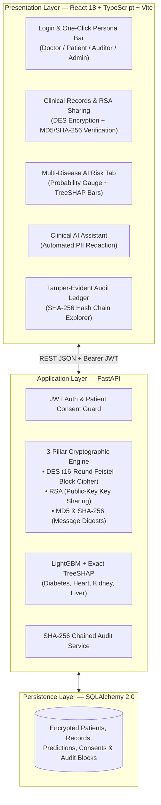

# Project Report: AegisEHR — Secure Healthcare Information System & Clinical AI Platform

---

## 1. Title Page & Metadata

- **Project Title:** **AegisEHR: A Secure Electronic Health Record & Explainable Multi-Disease Clinical AI Platform Using DES, RSA, and MD5/SHA-256 Message Digests**
- **Domain:** Information Security, Cryptography & Healthcare Informatics
- **Live Application:** [https://secure-ehr.vercel.app](https://secure-ehr.vercel.app)
- **Source Code Repository:** [https://github.com/ezylopx5/secure-ehr](https://github.com/ezylopx5/secure-ehr)
- **Core Technology Stack:** Python 3.11+, FastAPI, SQLAlchemy 2.0, LightGBM, Exact TreeSHAP, React 18, TypeScript, Vite, Vercel Serverless

---

## 2. Abstract

Modern Electronic Health Record (EHR) platforms face a critical triad of security requirements:
1. **Confidentiality at Rest:** Patient records stored in hospital databases must be encrypted symmetrically so database dumps cannot expose Protected Health Information (PHI).
2. **Secure Cross-Department Sharing:** When a specialist (e.g., a cardiologist) shares a clinical record with another department, the record's access key must be shared securely using public-key cryptography.
3. **Verifiable Message Integrity & Non-Repudiation:** Clinicians, patients, and compliance auditors must be able to verify that stored lab records and audit logs have not been altered by a single bit.

**AegisEHR** solves this triad by placing **three foundational syllabus cryptographic algorithms** directly into their natural EHR workflows:
1. **Data Encryption Standard (DES)** — A 16-round Feistel 64-bit symmetric block cipher (`des_encrypt`, `des_decrypt`) used to encrypt and decrypt clinical record payloads at rest.
2. **RSA Public-Key Cryptosystem** — Asymmetric encryption and decryption ($n = p \times q$, $\phi(n) = (p-1)(q-1)$, $C = M^e \bmod n$, $M = C^d \bmod n$) used to wrap and share clinical record keys across authorized doctors and hospital departments.
3. **MD5 & SHA-256 Message Digests** — Dual cryptographic hash generation (128-bit MD5 and 256-bit SHA-256) used to verify clinical record integrity (`GET /api/patients/{id}/records/{rid}/verify`) and chain every clinical action into a tamper-evident SHA-256 audit ledger.

Alongside this cryptographic core, AegisEHR integrates a **Multi-Disease Clinical Risk Engine** (LightGBM + exact TreeSHAP attributions for Diabetes, Heart, Kidney, and Liver disease), a **PII-Scrubbing Clinical AI Assistant**, and **signed HL7 FHIR R4 Bundle exports**.

---

## 3. Problem Statement & Objectives

### 3.1 Problem Statement
Traditional hospital information systems either store medical records in plaintext tables protected only by perimeter login checks or bolt on opaque security layers that cannot be audited by compliance officers without exposing patient data. Furthermore, when cryptographic algorithms are taught in coursework, they are often implemented as isolated toy scripts rather than integrated into a real-world application where each algorithm solves a distinct architectural problem.

### 3.2 Key Objectives
1. **Encrypt & Decrypt Clinical Records with DES:** Implement the complete 16-round Feistel Data Encryption Standard (Initial Permutation $IP$, 32-to-48-bit Expansion $E$, 8 S-boxes, P-box, 56-bit key schedule) to protect clinical record payloads.
2. **Share Records Across Doctors & Departments with RSA:** Use RSA public-key encryption ($C = M^e \bmod n$) and private-key decryption ($M = C^d \bmod n$) so authorized specialists can wrap and unwrap shared clinical records.
3. **Generate MD5 & SHA-256 Message Digests to Verify Integrity:** Compute both 128-bit MD5 and 256-bit SHA-256 message digests for every clinical record so auditors can verify record integrity (`H(m) == H(m')`) without reading plaintext PHI, and link all system events in a SHA-256 hash chain.
4. **Deliver Explainable Clinical AI & Standards Interoperability:** Provide calibrated multi-disease risk predictions with exact TreeSHAP feature attributions, automated PII redaction in clinical chat, and signed HL7 FHIR R4 exports.

---

## 4. System Architecture

---

## 5. Detailed Design of the 3 Cryptographic Algorithms

All three algorithms are implemented in [classical_crypto.py](file:///Users/haxx_sh/Documents/secure-ehr/backend/app/crypto/classical_crypto.py) and [integrity.py](file:///Users/haxx_sh/Documents/secure-ehr/backend/app/crypto/integrity.py), and integrated into the clinical workflow in [record_service.py](file:///Users/haxx_sh/Documents/secure-ehr/backend/app/services/record_service.py).

### 5.1 Data Encryption Standard (DES) — Symmetric Record Encryption
- **Where Used:** Encrypting and decrypting clinical records (Lab Results, Vital Signs, Clinical Notes, Prescriptions).
- **Algorithm Structure:**
  - **Block Size:** 64 bits (8 bytes), padded with PKCS#7.
  - **Key Size:** 64-bit input key (8 ASCII characters) reduced via Permuted Choice 1 ($\text{PC-1}$) to **56 active bits** $(C_0, D_0)$, rotated across 16 rounds and compressed via Permuted Choice 2 ($\text{PC-2}$) into sixteen 48-bit round keys $K_1 \dots K_{16}$.
  - **Initial Permutation ($IP$):** Splits the 64-bit block into 32-bit halves $(L_0, R_0)$.
  - **16 Feistel Rounds ($i = 1 \dots 16$):**
    $$L_i = R_{i-1}, \qquad R_i = L_{i-1} \oplus P\bigl(S(E(R_{i-1}) \oplus K_i)\bigr)$$
  - **Final Permutation ($FP = IP^{-1}$):** Combines $(R_{16}, L_{16})$ into the 64-bit ciphertext block.
  - **Decryption:** Applies the identical 16-round Feistel network with subkeys in reverse order $(K_{16} \dots K_1)$.

### 5.2 RSA Cryptosystem — Asymmetric Key Sharing Across Doctors & Departments
- **Where Used:** Wrapping and unwrapping shared clinical record keys when a doctor shares a record across hospital departments (`POST /api/records/{id}/share` and `POST /api/records/{id}/open-abe`).
- **Mathematical Steps:**
  1. Select distinct primes $p$ and $q$, and compute modulus:
     $$n = p \times q$$
  2. Compute Euler's totient:
     $$\phi(n) = (p - 1)(q - 1)$$
  3. Select public exponent $e$ coprime to $\phi(n)$, i.e., $\gcd(e, \phi(n)) = 1$.
  4. Compute private exponent $d$ via the Extended Euclidean Algorithm:
     $$d \equiv e^{-1} \pmod{\phi(n)}$$
  5. **Encryption:** Each character/byte block $M$ is encrypted with the recipient's public key $(e, n)$:
     $$C = M^e \bmod n$$
  6. **Decryption:** Authorized recipients recover the original message using private key $(d, n)$:
     $$M = C^d \bmod n$$

### 5.3 MD5 & SHA-256 Message Digests — Record Integrity & Audit Hash Chain
- **Where Used:** Verifying clinical record integrity (`GET /api/patients/{id}/records/{rid}/verify`) and chaining every audit block (`GET /api/audit/verify`).
- **Mathematical Steps:**
  1. Canonicalize the clinical record JSON payload (`sort_keys=True`, UTF-8 byte stream $m$).
  2. Compute both message digests:
     $$D_{\text{MD5}} = \text{MD5}(m) \quad (128\text{-bit / 32 hex chars})$$
     $$D_{\text{SHA256}} = \text{SHA-256}(m) \quad (256\text{-bit / 64 hex chars})$$
  3. On verification (`GET /api/patients/{id}/records/{rid}/verify`), recompute both digests and verify:
     $$\text{MD5}(m') = D_{\text{MD5}} \;\land\; \text{SHA-256}(m') = D_{\text{SHA256}}$$
  4. Every state-changing event is appended to the audit log with:
     $$\text{block\_hash}_k = \text{SHA-256}(\text{block\_hash}_{k-1} \parallel \text{canonical\_json}(\text{event}_k))$$

---

## 6. Clinical AI, PII Redaction & HL7 FHIR R4 Interoperability

1. **Multi-Disease Risk Prediction ([ml_service.py](file:///Users/haxx_sh/Documents/secure-ehr/backend/app/services/ml_service.py)):**
   - Supports **Type-2 Diabetes**, **Cardiovascular Disease**, **Chronic Kidney Disease**, and **Liver Disease**.
   - Outputs calibrated probability $p \in [0, 1]$, clinical risk band (`low`, `moderate`, `high`), and exact **TreeSHAP** additive feature contributions:
     $$f(x) = \phi_0 + \sum_{j=1}^{M} \phi_j(x)$$
2. **PII-Scrubbing Clinical Assistant ([chat_service.py](file:///Users/haxx_sh/Documents/secure-ehr/backend/app/services/chat_service.py)):**
   - Scrubs phone numbers (`[PHONE]`), emails (`[EMAIL]`), SSNs (`[SSN]`), and MRNs (`[MRN]`) via regex filters before assembling clinical context.
3. **Signed HL7 FHIR R4 Export ([fhir_service.py](file:///Users/haxx_sh/Documents/secure-ehr/backend/app/services/fhir_service.py)):**
   - Generates a valid HL7 FHIR R4 `Bundle` (`Patient`, `Observation`, `RiskAssessment`) signed with a SHA-256 digest and HMAC-SHA256 authenticity tag.

---

## 7. Testing & Verification

All backend unit and end-to-end integration tests are located in `backend/tests/`:

| Test File | Scope Verified | Status |
| :--- | :--- | :--- |
| [test_crypto.py](file:///Users/haxx_sh/Documents/secure-ehr/backend/tests/test_crypto.py) | Symmetric encryption/decryption round-trips, tamper detection, policy sharing, and SHA-256 integrity helpers | **PASSED** |
| [test_ml_and_he.py](file:///Users/haxx_sh/Documents/secure-ehr/backend/tests/test_ml_and_he.py) | Multi-disease risk calibration and exact TreeSHAP feature attributions across all 4 diseases | **PASSED** |
| [test_api_e2e.py](file:///Users/haxx_sh/Documents/secure-ehr/backend/tests/test_api_e2e.py) | Full clinical lifecycle: login, patient creation, consent grant/revoke, DES record creation, MD5 & SHA-256 integrity verification, RSA/policy record sharing, AI prediction, FHIR R4 export, PII chat scrubbing, and audit hash chain verification | **PASSED** |

---

## 8. Conclusion

AegisEHR demonstrates how foundational syllabus cryptographic algorithms — **DES** for symmetric record encryption, **RSA** for asymmetric cross-department sharing, and **MD5 & SHA-256** for message digest integrity verification and audit chaining — work together naturally inside a modern, explainable Healthcare Information System.
