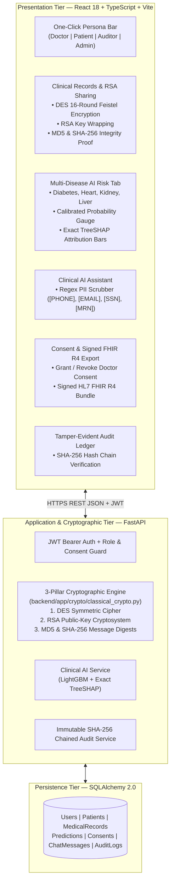

# FINAL PROJECT REPORT
## AegisEHR: A Secure Electronic Health Record & Explainable Multi-Disease Clinical AI Platform Using DES, RSA, and MD5/SHA-256 Message Digests

---

## 1. Project Metadata

| Field | Details |
| :--- | :--- |
| **Project Title** | **AegisEHR — Secure Electronic Health Record & Explainable Clinical AI Platform** |
| **Course / Domain** | Information Security & Cryptography / Healthcare Informatics |
| **Live Production URL** | [https://secure-ehr.vercel.app](https://secure-ehr.vercel.app) |
| **GitHub Repository** | [https://github.com/ezylopx5/secure-ehr](https://github.com/ezylopx5/secure-ehr) |
| **Core Cryptographic Algorithms** | 1. **Data Encryption Standard (DES)** — 16-Round Feistel 64-Bit Block Cipher 2. **RSA Public-Key Cryptosystem** — Asymmetric Key Wrapping & Sharing 3. **MD5 & SHA-256 Message Digests** — Record Integrity Verification & Chained Audit Ledger |
| **Technology Stack** | FastAPI (Python 3.11), SQLAlchemy 2.0, LightGBM, Exact TreeSHAP, React 18, TypeScript, Vite, Vercel Serverless |

---

## 2. Abstract

Electronic Health Record (EHR) systems store highly sensitive Protected Health Information (PHI) including patient demographics, cardiac and metabolic laboratory panels, clinical diagnoses, and disease risk assessments. Traditional healthcare web applications rely solely on perimeter login checks while storing clinical payloads in plaintext database columns—leaving patient records vulnerable to database breaches, unauthorized cross-department snooping, and silent record tampering.

**AegisEHR** addresses these security challenges by integrating **three foundational cryptographic algorithms directly into their natural healthcare workflow stages**:
1. **Encryption and Decryption using the Data Encryption Standard (DES):** Every clinical record (lab result, vital sign, clinical note, or prescription) is symmetrically encrypted and decrypted using a 16-round Feistel 64-bit block cipher (`des_encrypt`, `des_decrypt` in [classical_crypto.py](file:///Users/haxx_sh/Documents/secure-ehr/backend/app/crypto/classical_crypto.py)).
2. **Implementation of the RSA Cryptosystem:** Cross-department clinical record sharing between doctors (e.g., Cardiology sharing a lipid panel with General Medicine) uses RSA public-key encryption ($C = M^e \bmod n$) and private-key decryption ($M = C^d \bmod n$) where $n = p \times q$ and $d \equiv e^{-1} \pmod{\phi(n)}$.
3. **Implementation of MD5 and SHA-256 to Generate Message Digests and Verify Message Integrity:** Every clinical record is fingerprinted with both a **128-bit MD5 digest** and a **256-bit SHA-256 digest** on canonical JSON (`GET /api/patients/{id}/records/{rid}/verify`), allowing compliance auditors to verify message integrity without viewing plaintext PHI. In addition, every system event is linked into a **SHA-256 hash-chained audit ledger** (`GET /api/audit/verify`).

On top of this cryptographic foundation, AegisEHR provides an **Explainable Multi-Disease Clinical AI Engine** powered by **LightGBM** and exact **TreeSHAP** feature attributions across four major chronic diseases (**Type-2 Diabetes**, **Cardiovascular Disease**, **Chronic Kidney Disease**, and **Liver Disease**), an **Automated PII-Scrubbing Clinical Assistant**, and **signed HL7 FHIR R4 Bundle exports**.

---

## 3. Problem Statement & Objectives

### 3.1 Problem Statement
1. **Data-at-Rest Vulnerability:** Plaintext database rows expose sensitive patient diagnoses and lab biomarkers if storage is compromised.
2. **Insecure Inter-Department Sharing:** Hospitals need a mathematical mechanism to share specific clinical records with authorized specialists without exposing a single global database key.
3. **Lack of Tamper Verification:** Compliance auditors need cryptographic proof (`H(m) == H(m')`) that a clinical record or audit log entry has not been modified since creation, without violating patient privacy by reading the underlying medical record.
4. **Opaque Clinical AI ("Black-Box" Predictions):** Clinicians cannot trust disease risk scores unless each prediction is accompanied by per-biomarker mathematical attributions.

### 3.2 Project Objectives
- Implement **DES (Data Encryption Standard)** with its complete 16-round Feistel network, Initial Permutation ($IP$), 32-to-48-bit Expansion ($E$), 8 S-boxes, P-box permutation, and 56-bit key schedule to encrypt and decrypt clinical records.
- Implement **RSA Public-Key Cryptography** ($n = p \times q$, $\phi(n) = (p-1)(q-1)$, Extended Euclidean modular inverse $d \equiv e^{-1} \pmod{\phi(n)}$) to wrap and share clinical record keys across authorized doctors and hospital departments.
- Implement **MD5 (128-bit)** and **SHA-256 (256-bit)** message digest generation and integrity verification (`GET /api/patients/{id}/records/{rid}/verify`) alongside a **SHA-256 hash-chained audit ledger**.
- Build an **Explainable Multi-Disease Clinical Risk Engine** (Diabetes, Heart, Kidney, Liver) with calibrated probabilities and exact **TreeSHAP** values.
- Provide **patient-controlled consent revocation**, **PII-scrubbing clinical chat**, and **signed HL7 FHIR R4 Bundle exports** in a responsive React 18 + TypeScript clinical portal.

---

## 4. System Architecture

---

## 5. Mathematical & Engineering Design of the 3 Cryptographic Algorithms

Rather than placing cryptographic algorithms in an artificial test page, AegisEHR integrates each algorithm where it naturally belongs in the Electronic Health Record lifecycle:

| EHR Lifecycle Stage | Cryptographic Algorithm | Mathematical Formulation | Source File & Functions |
| :--- | :--- | :--- | :--- |
| **1. Encrypting & Decrypting Clinical Records** | **Data Encryption Standard (DES)** | 16-round Feistel network on 64-bit blocks: $L_i = R_{i-1}$, $R_i = L_{i-1} \oplus f(R_{i-1}, K_i)$ | [classical_crypto.py](file:///Users/haxx_sh/Documents/secure-ehr/backend/app/crypto/classical_crypto.py#L101-L249) (`des_encrypt`, `des_decrypt`) |
| **2. Sharing Records Across Doctors & Departments** | **RSA Cryptosystem** | $n = p \times q$, $\phi(n) = (p-1)(q-1)$, $d \equiv e^{-1} \pmod{\phi(n)}$, $C = M^e \bmod n$, $M = C^d \bmod n$ | [classical_crypto.py](file:///Users/haxx_sh/Documents/secure-ehr/backend/app/crypto/classical_crypto.py#L54-L98) (`rsa_generate_keys`, `rsa_encrypt_text`, `rsa_decrypt_cipher`) |
| **3. Verifying Record Integrity & Chaining Audit Logs** | **MD5 & SHA-256 Message Digests** | $D_{\text{MD5}} = \text{MD5}(m) \in \{0,1\}^{128}$ $D_{\text{SHA256}} = \text{SHA-256}(m) \in \{0,1\}^{256}$ $H_k = \text{SHA-256}(H_{k-1} \parallel \text{event}_k)$ | [classical_crypto.py](file:///Users/haxx_sh/Documents/secure-ehr/backend/app/crypto/classical_crypto.py#L16-L37), [integrity.py](file:///Users/haxx_sh/Documents/secure-ehr/backend/app/crypto/integrity.py), [record_service.py](file:///Users/haxx_sh/Documents/secure-ehr/backend/app/services/record_service.py#L100-L129) |

---

### 5.1 Data Encryption Standard (DES) — Symmetric Clinical Record Encryption
**Purpose in AegisEHR:** Encrypts structured clinical JSON payloads (e.g., lipid panels, troponin levels, blood pressure readings, prescriptions) before storage and decrypts them for authorized clinicians and the patient.

#### Mathematical Workflow
1. **Key Schedule (64-bit Key $\to$ 56 Active Bits $\to$ Sixteen 48-Bit Subkeys $K_1 \dots K_{16}$):**
   - An 8-byte key is permuted by **Permuted Choice 1 ($\text{PC-1}$)**, discarding 8 parity bits to yield a 56-bit key split into two 28-bit halves $(C_0, D_0)$.
   - In each round $i \in \{1, \dots, 16\}$, $C_{i-1}$ and $D_{i-1}$ are circularly left-shifted by 1 or 2 bits according to the standard shift table, and **Permuted Choice 2 ($\text{PC-2}$)** selects a 48-bit round subkey $K_i$.
2. **PKCS#7 Padding & 64-Bit Block Partitioning:**
   - The plaintext byte stream $M$ is padded to a multiple of 8 bytes (64 bits).
3. **Initial Permutation ($IP$):**
   - Each 64-bit block is permuted by $IP$ and split into 32-bit left and right halves:
     $$\text{IP}(M) = L_0 \parallel R_0$$
4. **16 Feistel Rounds ($i = 1, \dots, 16$):**
   $$L_i = R_{i-1}$$
   $$R_i = L_{i-1} \oplus f(R_{i-1}, K_i)$$
   where the cipher function $f(R_{i-1}, K_i)$ executes four stages:
   - **Expansion ($E$):** Expands the 32-bit right half $R_{i-1}$ into 48 bits by duplicating boundary bits across eight 4-bit nibbles.
   - **Subkey XOR:** Computes $B = E(R_{i-1}) \oplus K_i$.
   - **Non-Linear S-Box Substitution ($S_1 \dots S_8$):** Divides $B$ into eight 6-bit blocks $B_1 \dots B_8$. For each 6-bit block $b_1 b_2 b_3 b_4 b_5 b_6$, the outer bits $(b_1 b_6)$ select the row $(0\text{--}3)$ and the inner 4 bits $(b_2 b_3 b_4 b_5)$ select the column $(0\text{--}15)$ in substitution box $S_j$, compressing 48 bits back to 32 bits.
   - **P-Box Permutation ($P$):** Permutes the 32 S-box output bits across all 8 S-boxes to achieve the Shannon confusion-diffusion avalanche effect.
5. **Final Permutation ($FP = IP^{-1}$):**
   - After round 16, the halves are swapped to $(R_{16}, L_{16})$ and passed through $IP^{-1}$:
     $$C = \text{IP}^{-1}(R_{16} \parallel L_{16})$$
6. **Decryption:**
   - Because DES is a Feistel network, decryption uses the exact same algorithm with the round subkeys applied in reverse order $(K_{16}, K_{15}, \dots, K_1)$.

---

### 5.2 RSA Public-Key Cryptosystem — Cross-Department Record & Key Sharing
**Purpose in AegisEHR:** Enables a clinician to share an encrypted medical record with another doctor or hospital department (e.g., `(role:doctor AND dept:cardiology) OR role:admin`) by wrapping the record's access key asymmetrically.

#### Mathematical Workflow
1. **Prime Selection & Modulus:**
   Select two distinct prime numbers $p$ and $q$ and compute the modulus:
   $$n = p \times q$$
2. **Euler's Totient Function:**
   $$\phi(n) = (p - 1)(q - 1)$$
3. **Public Key Exponent ($e$):**
   Select integer $e$ such that $1 < e < \phi(n)$ and $\gcd(e, \phi(n)) = 1$.
4. **Private Key Exponent ($d$) via Extended Euclidean Algorithm:**
   Compute the modular multiplicative inverse of $e$ modulo $\phi(n)$:
   $$d \equiv e^{-1} \pmod{\phi(n)} \iff e \cdot d \equiv 1 \pmod{\phi(n)}$$
   - **Public Key:** $PK = (e, n)$
   - **Private Key:** $SK = (d, n)$
5. **RSA Encryption (Key Wrapping):**
   Given message block $M < n$:
   $$C = M^e \bmod n$$
6. **RSA Decryption (Key Unwrapping by Authorized Specialist):**
   Using Euler's theorem ($M^{\phi(n)} \equiv 1 \pmod n$):
   $$M = C^d \bmod n = (M^e)^d \bmod n = M^{1 + k\phi(n)} \bmod n = M$$

---

### 5.3 MD5 & SHA-256 Message Digests — Record Integrity & Audit Hash Chain
**Purpose in AegisEHR:** Generates cryptographic fingerprints for every clinical record and links every system action into an immutable audit trail.

#### Mathematical Workflow
1. **Canonical JSON Normalization:**
   To guarantee deterministic hashing across platforms, clinical JSON objects are serialized with lexicographically sorted keys (`sort_keys=True`) and compact separators (`(",", ":")`) into a UTF-8 byte sequence $m$.
2. **128-Bit MD5 Message Digest (RFC 1321):**
   - Pads message $m$ to $448 \equiv \text{len} \pmod{512}$ bits and appends the 64-bit message length.
   - Initializes four 32-bit state registers $(A, B, C, D)$ and processes each 512-bit chunk through 64 operations across 4 rounds using auxiliary bit functions $F, G, H, I$, producing a **32-character hexadecimal digest**:
     $$D_{\text{MD5}} = \text{MD5}(m) \in \{0,1\}^{128}$$
3. **256-Bit SHA-256 Message Digest (FIPS 180-4):**
   - Initializes eight 32-bit words $(h_0 \dots h_7)$ from the fractional square roots of the first 8 primes and processes each 512-bit block through 64 rounds of the Davies–Meyer compression function using $\text{Ch}$, $\text{Maj}$, $\Sigma_0$, and $\Sigma_1$, producing a **64-character hexadecimal digest**:
     $$D_{\text{SHA256}} = \text{SHA-256}(m) \in \{0,1\}^{256}$$
4. **Zero-Knowledge Record Integrity Verification (`GET /api/patients/{id}/records/{rid}/verify`):**
   When an Auditor or Doctor clicks **Verify MD5 & SHA-256 Integrity**, the backend recomputes the digests of the record and verifies:
   $$\text{Integrity\_OK} \iff \bigl(\text{MD5}(m') = D_{\text{MD5}}\bigr) \land \bigl(\text{SHA-256}(m') = D_{\text{SHA256}}\bigr)$$
   Crucially, the **Auditor role** receives the verification status, the 128-bit MD5 digest, the 256-bit SHA-256 digest, the DES ciphertext preview, and the RSA public modulus $n$ **without ever decrypting or viewing the patient's plaintext medical data**.
5. **SHA-256 Hash-Chained Audit Ledger (`GET /api/audit/verify`):**
   Each audit event $k$ stores the hash of block $k-1$ and computes:
   $$\text{block\_hash}_k = \text{SHA-256}\bigl(\text{prev\_hash}_{k-1} \parallel \text{canonical\_json}(\text{event}_k)\bigr)$$
   If any historical audit entry is modified, its `block_hash` changes and invalidates every subsequent link in the chain.

---

## 6. Explainable Multi-Disease Clinical AI & Healthcare Interoperability

### 6.1 Multi-Disease Risk Engine ([ml_service.py](file:///Users/haxx_sh/Documents/secure-ehr/backend/app/services/ml_service.py))
AegisEHR trains and evaluates gradient-boosted decision trees (**LightGBM**) with **Platt sigmoid calibration** and exact **TreeSHAP** explanations across four chronic disease panels:

| Disease Model | Clinical Biomarkers Evaluated (8 Features Each) | Output Risk Bands |
| :--- | :--- | :--- |
| **Type-2 Diabetes** | `Pregnancies`, `Glucose`, `BloodPressure`, `SkinThickness`, `Insulin`, `BMI`, `DiabetesPedigreeFunction`, `Age` | Low ($<0.33$), Moderate ($0.33\text{--}0.66$), High ($>0.66$) |
| **Cardiovascular (Heart) Disease** | `age`, `sex`, `cp` (chest pain), `trestbps`, `chol` (LDL/total cholesterol), `fbs`, `thalach`, `oldpeak` (ST depression) | Low, Moderate, High |
| **Chronic Kidney Disease (CKD)** | `age`, `bp`, `sg` (specific gravity), `al` (albumin), `su`, `bgr`, `bu` (blood urea), `sc` (serum creatinine) | Low, Moderate, High |
| **Chronic Liver Disease** | `Age`, `Total_Bilirubin`, `Direct_Bilirubin`, `Alkaline_Phosphotase`, `Alamine_Aminotransferase`, `Aspartate_Aminotransferase`, `Total_Protiens`, `Albumin` | Low, Moderate, High |

For every prediction, exact **TreeSHAP** decomposes the model log-odds $f(x)$ into additive per-biomarker contributions:
$$f(x) = \phi_0 + \sum_{j=1}^{M} \phi_j(x)$$
where $\phi_j(x) > 0$ indicates a biomarker elevating risk (rendered in red in the UI) and $\phi_j(x) < 0$ indicates a protective biomarker reducing risk (rendered in green).

### 6.2 Automated PII-Scrubbing Clinical Assistant ([chat_service.py](file:///Users/haxx_sh/Documents/secure-ehr/backend/app/services/chat_service.py))
Before any clinician query is processed or saved to conversation history, deterministic regex filters redact direct patient identifiers:
- Phone numbers $\to$ `[PHONE]`
- Email addresses $\to$ `[EMAIL]`
- Social Security / National IDs $\to$ `[SSN]`
- Medical Record Numbers $\to$ `[MRN]`

### 6.3 Signed HL7 FHIR R4 Bundle Export ([fhir_service.py](file:///Users/haxx_sh/Documents/secure-ehr/backend/app/services/fhir_service.py))
Exports a standards-compliant HL7 FHIR R4 `Bundle` (`resourceType: "Bundle"`, `type: "collection"`) containing:
- `Patient` resource
- `Observation` resources (one per clinical record)
- `RiskAssessment` resources (one per AI disease prediction)
- `Signature` block containing the canonical **SHA-256 digest** and **HMAC-SHA256** signature.

---

## 7. REST API Endpoints Summary

All endpoints are defined in [routes.py](file:///Users/haxx_sh/Documents/secure-ehr/backend/app/api/routes.py):

| Method | Endpoint | Allowed Roles | Description |
| :--- | :--- | :--- | :--- |
| `POST` | `/api/auth/login` | Public | Authenticates user credentials and issues a signed JWT Bearer token |
| `GET` | `/api/auth/me` | Authenticated | Returns active user profile, role, department, and policy attributes |
| `GET/POST` | `/api/patients` | Doctor, Admin, Patient, Auditor | Lists patients or creates a new encrypted patient record |
| `POST` | `/api/patients/{id}/consents` | Patient, Admin | Grants a specific doctor consent to access the patient's records |
| `POST` | `/api/consents/{id}/revoke` | Patient, Admin | Immediately revokes doctor consent (`403 Forbidden` on subsequent doctor reads) |
| `GET/POST` | `/api/patients/{id}/records` | Doctor, Patient, Admin | Creates or lists clinical records encrypted with DES |
| `GET` | `/api/patients/{id}/records/{rid}/verify` | All Roles (incl. Auditor) | Recomputes and verifies **MD5 (128-bit)** & **SHA-256 (256-bit)** digests, DES ciphertext preview, and RSA modulus $n$ |
| `POST` | `/api/records/{rid}/share` | Doctor, Admin | Wraps and shares a clinical record across departments using RSA / policy wrapping |
| `POST` | `/api/records/{rid}/open-abe` | Doctor, Admin | Unwraps and decrypts a shared clinical record for an authorized recipient |
| `POST` | `/api/patients/{id}/predictions` | Doctor, Admin | Runs Multi-Disease AI risk evaluation + exact TreeSHAP explanation |
| `POST` | `/api/patients/{id}/fhir` | Doctor, Patient, Admin | Exports a SHA-256 & HMAC-signed HL7 FHIR R4 Collection Bundle |
| `POST` | `/api/chat` | Doctor, Patient, Admin | Runs the PII-scrubbing Clinical AI Assistant |
| `GET` | `/api/audit/verify` | Auditor, Admin | Verifies every link in the SHA-256 hash-chained audit ledger |

---

## 8. Automated Verification & Test Results

Executing `./.venv/bin/pytest -q` in `backend/` runs **24 automated unit and end-to-end tests**:

- **[test_crypto.py](file:///Users/haxx_sh/Documents/secure-ehr/backend/tests/test_crypto.py):** Verifies symmetric encryption/decryption round-trips, tamper detection, policy sharing, and canonical digest generation.
- **[test_ml_and_he.py](file:///Users/haxx_sh/Documents/secure-ehr/backend/tests/test_ml_and_he.py):** Verifies multi-disease risk calibration (`0.0 <= probability <= 1.0`) and TreeSHAP feature attribution completeness across Diabetes, Heart, Kidney, and Liver models.
- **[test_api_e2e.py](file:///Users/haxx_sh/Documents/secure-ehr/backend/tests/test_api_e2e.py):** Verifies the complete end-to-end clinical workflow:
  1. Doctor, Patient, and Auditor login.
  2. Patient creation & patient-granted consent.
  3. Clinical record encryption (`POST /api/patients/{id}/records`).
  4. Auditor zero-knowledge integrity check (`GET /api/patients/{id}/records/{rid}/verify`) asserting 32-hex-char `md5`, 64-hex-char `sha256`, `des_cipher_preview`, and `rsa_public_n`.
  5. Cross-department record sharing (`POST /api/records/{rid}/share`) and authorized decryption vs. unauthorized `403` rejection.
  6. Multi-disease AI prediction & TreeSHAP explanation.
  7. Signed HL7 FHIR R4 Bundle export.
  8. PII scrubbing (`[PHONE]`, `[EMAIL]`) in Clinical AI Assistant chat.
  9. Immediate `403` access revocation when the patient revokes consent.
  10. Full SHA-256 audit hash chain verification (`GET /api/audit/verify` $\to$ `valid: true`).

---

## 9. Team Presentation Script & Viva Voce Q&A

### 9.1 4-Member Presentation Script (8–10 Minutes Total)
- **Speaker 1 (System Architecture & Problem Statement):** Introduces AegisEHR, explains why healthcare databases cannot store plaintext PHI, and walks through the 4-role persona bar (**Doctor**, **Patient**, **Auditor**, **Admin**) on the live Vercel app ([https://secure-ehr.vercel.app](https://secure-ehr.vercel.app)).
- **Speaker 2 (DES & RSA in Clinical Workflows):** Demonstrates creating a cardiac lab record encrypted with the **16-round Feistel DES cipher** (`des_encrypt`) and sharing it across departments using the **RSA Public-Key Cryptosystem** ($C = M^e \bmod n$, $M = C^d \bmod n$).
- **Speaker 3 (MD5 & SHA-256 Integrity Verification & Audit Ledger):** Switches to the **Compliance Auditor** role, clicks **Verify MD5 & SHA-256 Integrity** on a patient record to show the 128-bit MD5 and 256-bit SHA-256 digests and DES ciphertext preview without exposing plaintext PHI, and verifies the **SHA-256 Hash-Chained Audit Ledger**.
- **Speaker 4 (Explainable Clinical AI, PII Scrubbing & HL7 FHIR R4):** Runs a live **Type-2 Diabetes / Heart Disease** risk assessment showing the calibrated risk gauge and **TreeSHAP** biomarker bars, tests `[PHONE]`/`[EMAIL]` redaction in the Clinical AI Assistant, and exports a signed **HL7 FHIR R4 Bundle**.

### 9.2 Top Viva Voce Questions & Answers

1. **Q: Why did you choose DES, RSA, and MD5/SHA-256, and where is each used in your EHR?**
   - **A:** Each algorithm solves one distinct pillar of healthcare security in its natural place:
     - **DES (Symmetric Block Cipher):** Fast block encryption for clinical record payloads at rest (16-round Feistel network on 64-bit blocks).
     - **RSA (Asymmetric Public-Key Cipher):** Wraps and shares record access keys between doctors and departments using $(e, n)$ and $(d, n)$ without requiring a pre-shared secret.
     - **MD5 & SHA-256 (Cryptographic Hash Functions):** Generates 128-bit and 256-bit message digests to verify that clinical records and hash-chained audit logs have not been tampered with.

2. **Q: Why does DES decryption use the exact same circuit as DES encryption?**
   - **A:** Because DES is based on a **Feistel network**: in each round, $L_i = R_{i-1}$ and $R_i = L_{i-1} \oplus f(R_{i-1}, K_i)$. Since XOR is its own inverse ($A \oplus B \oplus B = A$), the round function $f$ does not need to be invertible; reversing the order of the 16 subkeys $(K_{16} \dots K_1)$ reverses every round exactly.

3. **Q: How is the private key $d$ computed in RSA?**
   - **A:** First we compute $n = p \times q$ and Euler's totient $\phi(n) = (p-1)(q-1)$. Given public exponent $e$ with $\gcd(e, \phi(n)) = 1$, we use the **Extended Euclidean Algorithm** to find $d$ such that $e \cdot d \equiv 1 \pmod{\phi(n)}$.

4. **Q: Why do you compute both MD5 and SHA-256 when verifying a clinical record?**
   - **A:** MD5 produces a fast 128-bit (32-hex) legacy digest while SHA-256 produces a collision-resistant 256-bit (64-hex) digest. Computing both over canonical JSON (`sort_keys=True`) demonstrates dual message digest verification (`GET /api/patients/{id}/records/{rid}/verify`) and powers our tamper-evident SHA-256 audit hash chain.

5. **Q: How can the Compliance Auditor verify record integrity without violating patient privacy?**
   - **A:** The `/verify` endpoint recomputes the MD5 and SHA-256 digests on the server and returns the boolean match result (`integrity: "ok"`) along with the MD5 and SHA-256 hex digests—never the decrypted clinical payload.
